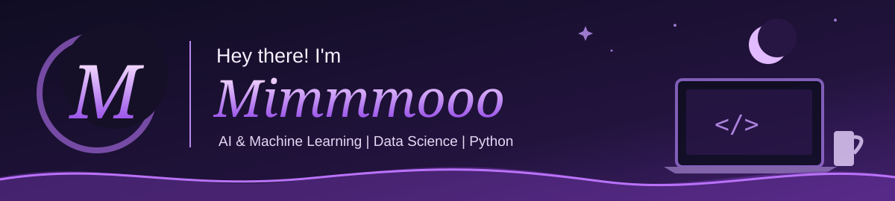

### ✦ About Me

I'm a curious learner exploring **Artificial Intelligence, Machine Learning, and Data Science**. I enjoy building practical applications, experimenting with data, and exploring new approaches to solving problems.

**RESEARCH & INTERESTS**

     

**CURRENT FOCUS**

   

### ⚙️ Tech Stack

**Programming Languages**

**Libraries & Frameworks Used Across My Repositories**

                      

**Tools & Platforms**

     

### 🚀 Selected Projects

<table>
<tr>
<td width="50%" valign="top">

**[StudyRAG](https://github.com/Mimmmooo/StudyRAG)**

Local-first document question answering with RAG, multilingual retrieval, and a Streamlit interface.

</td>
<td width="50%" valign="top">

**[Bangla-VLM](https://github.com/Mimmmooo/Bangla-VLM)**

Research on answer consistency across Bangla paraphrases of image-grounded questions.

</td>
</tr>
<tr>
<td width="50%" valign="top">

**[Earbud Manager](https://github.com/Mimmmooo/earbud-manager)**

Ubuntu GNOME Bluetooth earbuds manager built with Python, GTK 4, and libadwaita.

</td>
<td width="50%" valign="top">

**[Python Small Projects](https://github.com/Mimmmooo/Python-small-projects)**

Small Python applications and programming experiments.

</td>
</tr>
</table>

### 📈 GitHub Activity

**Selina Akter Mim · @Mimmmooo**

### 🔗 Connect With Me

